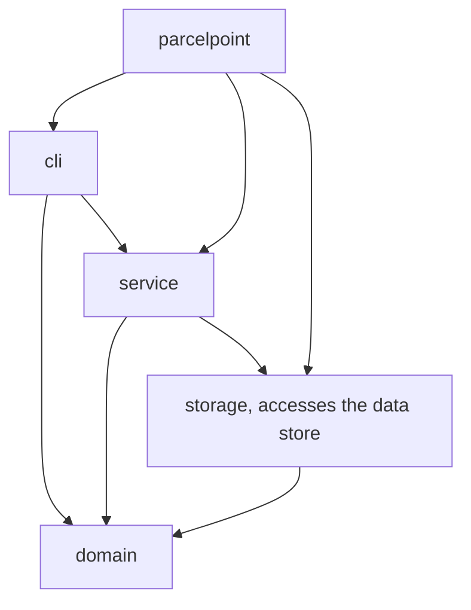
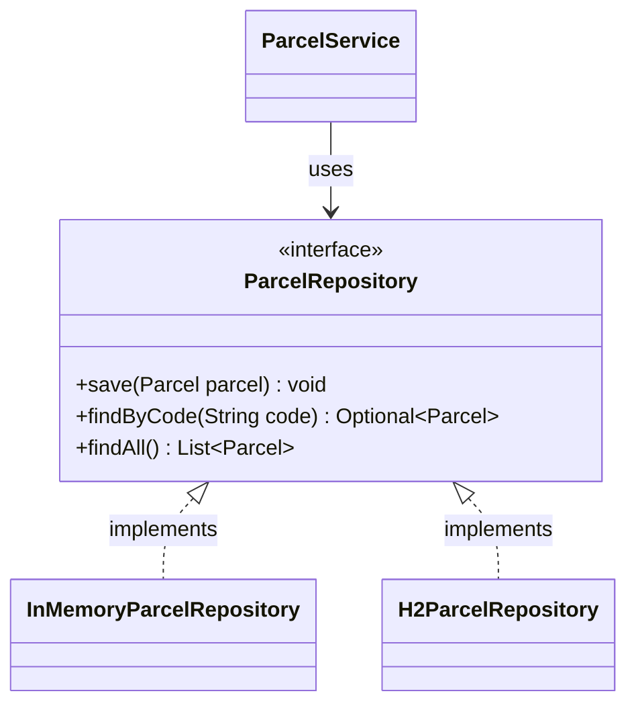
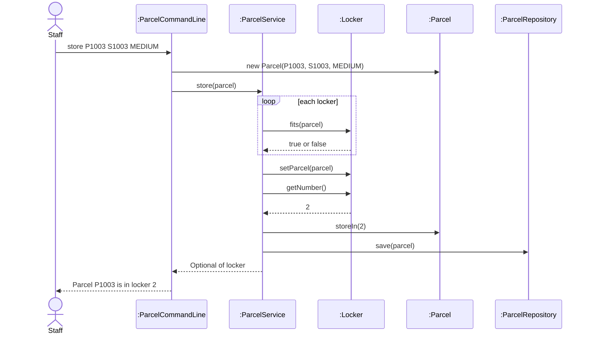

# Lab Report, Designing the Data Management Layer with H2

Repository URL: https://github.com/tanyawat-pat/itcs382-h2-lab

## Tools

| Item | Version or name |
| --- | --- |
| JDK | Eclipse Temurin 25.0.5 |
| Maven | Apache Maven 3.10.0 |
| IDE | Visual Studio Code 1.146.0 |
| AI tool and exact model, if you used one | OpenAI Codex (GPT-5) |

## Part 0. From a store in memory to H2

Commit of the starter, before any change: 5dad492

0.3 Your prediction for `staff`, written before the second run: I predict that no parcels will be listed and all three lockers will be free, because the program has been restarted.

Output of the second run, for `staff` and `quit`:

```
> staff
Free lockers: 3
> quit
```

State in one sentence where you think the parcels of the first run were kept. 
- The parcels from the first run were stored in a Java Map in the program's memory, so they disappeared when the program ended.

0.5 The line of Main that you would change to keep the parcels somewhere else:

```
ParcelRepository repository = new InMemoryParcelRepository();
```

0.6 Commit of the switch to H2: 02a30aa

0.7 Output of `SELECT * FROM PARCEL;` after you stored two parcels:

```
sql> SELECT * FROM PARCEL;
CODE  | STUDENT_ID | PARCEL_SIZE | STATUS | LOCKER_NUMBER
P1001 | S1001      | SMALL       | STORED | 1
P1002 | S1002      | LARGE       | STORED | 3
(2 rows, 35 ms)
```

0.8 Explain why ParcelPoint could not start while the H2 Shell was open, and identify the class that wrote the message `Cannot create the PARCEL table`. 
- ParcelPoint could not start because the H2 Shell already had the embedded database open and locked its file, so a second program could not open it at the same time. H2ParcelRepository wrote the message "Cannot create the PARCEL table" when its constructor caught the database exception.

0.9 Explain why `staff` shows no parcel while `find` shows each one, and why all three lockers look free.
- staff shows no parcels because it calls H2ParcelRepository.findAll(), which currently returns an empty list, while find calls the completed findByCode() method. ParcelService rebuilds the locker state from findAll() when it starts, so receiving an empty list makes all three lockers appear free.

0.11 Your findAll method:

```
@Override
public List<Parcel> findAll() {
    String sql = "SELECT * FROM PARCEL ORDER BY CODE";
    List<Parcel> parcels = new ArrayList<>();

    try (Connection connection = connect();
         PreparedStatement statement = connection.prepareStatement(sql);
         ResultSet row = statement.executeQuery()) {
        while (row.next()) {
            parcels.add(toParcel(row));
        }
    } catch (SQLException e) {
        throw new IllegalStateException("Cannot read the parcels", e);
    }

    return parcels;
}
```

Commit that adds findAll: b534653

0.12 Output of `SELECT * FROM PARCEL;` after the pickup:

```
sql> SELECT * FROM PARCEL;
CODE  | STUDENT_ID | PARCEL_SIZE | STATUS    | LOCKER_NUMBER
P1001 | S1001      | SMALL       | PICKED_UP | null
P1002 | S1002      | LARGE       | STORED    | 3
(2 rows, 30 ms)
```

0.13 Optional. Describe what `find P9999'OR'1'='1` showed while the SQL was joined from strings, and what it showed after you put the placeholder back.

## Part A. Model the design

A1 Complete the flowchart with one node for each package and one arrow for each dependency, from the package that uses to the package that is used. Mark the package that accesses the data store.



State whether cli depends on storage, and explain why.
- cli does not depend on storage. It communicates with ParcelService in the service package, while the service layer accesses storage through ParcelRepository.

A2 Complete the class diagram of the data management layer with ParcelService, the interface ParcelRepository with its three operations, and the two classes that implement it.



A3 Draw a sequence diagram for the command `store P1003 S1003 MEDIUM`, from the staff member to the repository. Show each message as an operation of the class that receives it.



Explain why the last lifeline is the interface ParcelRepository rather than H2ParcelRepository.
- The last lifeline is ParcelRepository because ParcelService sends save() to the repository interface and does not know which concrete implementation is being used. Main may provide H2ParcelRepository or another implementation without changing ParcelService.

## Part B. Design questions

1. Identify the files that you changed to move from the store in memory to H2, and explain why no other class had to change. Use the terms of this course.
- I changed Main.java to replace InMemoryParcelRepository with H2ParcelRepository, and I later completed findAll() in H2ParcelRepository.java. No CLI, domain, or business-layer class needed to change because ParcelService depends on the ParcelRepository interface, following the Dependency Inversion Principle. Main is the composition point that selects the concrete data-store implementation.

2. The PARCEL table stores the size of a parcel as SMALL, MEDIUM or LARGE rather than as 1, 2 or 3. Identify the type of connascence between ParcelSize and the table in each case, and explain which one is weaker.
- Storing SMALL, MEDIUM, and LARGE creates connascence of name because the table and ParcelSize must agree on the enum names. Storing 1, 2, and 3 would create connascence of convention because both sides must agree on the meaning assigned to each number. Connascence of name is weaker because the stored values are self-describing and a mismatch is easier to detect.

3. Project Phase 2 asks for a data store that needs no separate server. Explain why an embedded database such as H2 meets this rule, and describe the limit of an embedded database that Step 0.8 showed.
- H2 meets the requirement because it runs as an embedded library inside the application and does not require a separate database server. It can also create its tables and database file when the application first runs. However, Step 0.8 showed that another process cannot open the same embedded database file while it is locked.

4. State the data store that you would choose for your Project Phase 2 team, files or an embedded database, the requirement that drives the choice, and the package that will access it.
- I would choose files because the project requires persistent data without a separate server, and the existing design stores science plans and observing programs as .properties files. The ocs.persistence package accesses the data store through FileSciencePlanRepository. The business layer remains independent of the file format because SciencePlanService depends on the SciencePlanRepository interface.

## AI usage declaration

| AI tool and exact model | Date | Purpose | Files or answers it produced or changed | How you checked its output |
| OpenAI Codex (GPT-5) | 17 November 2026 | Guided the lab steps, explained the repository design, helped complete findAll, and drafted the diagrams and report answers | H2ParcelRepository.findAll, Part 0 explanations, Part A diagrams, and Part B answers | I built the project with Maven, ran each ParcelPoint command, inspected the database with H2 Shell, checked the Mermaid previews, and compared the Project Phase 2 answer with the team's code and package diagram. |
